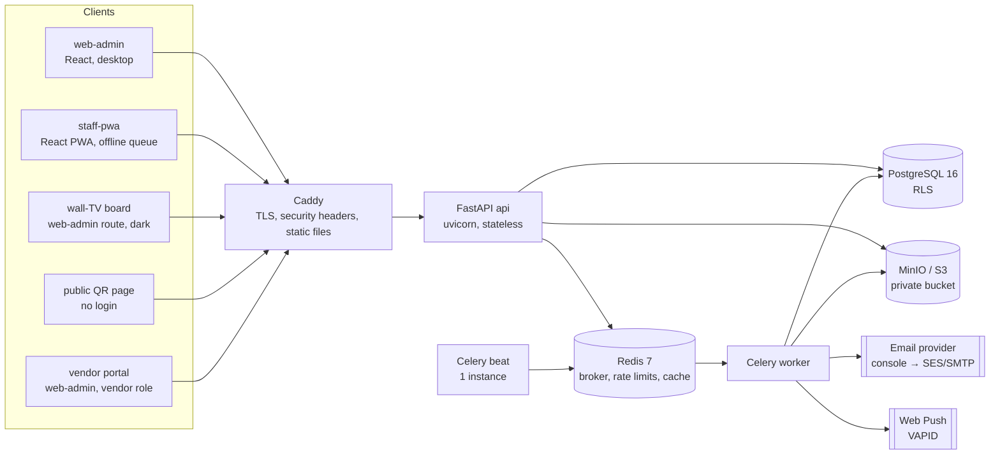

# Architecture

Status: Phase 0 draft for approval · Inputs: `BUILD_PROMPT.md`, `decisions.md`

## 1. Components



| Component | Responsibility |
|---|---|
| **api** | All HTTP endpoints. Auth, policy checks, state machine, uploads to quarantine, presigned GET URLs. Stateless; scales horizontally. |
| **worker** | Recurring task generation, SLA timer firing, escalations, notification delivery, evidence processing (validate, re-encode, strip EXIF, watermark), retention purges, exports (PDF/CSV), audit-chain verification. |
| **beat** | Only the *ticks*: it enqueues sweeps every N seconds. It holds no timer state; all timers live in Postgres (§5). |
| **postgres** | System of record. RLS for tenant isolation. Append-only audit log with hash chain. |
| **redis** | Celery broker/result backend, rate-limit counters, short-lived caches. **Not** a source of truth: losing Redis loses no business data. |
| **minio/S3** | Evidence photos and exports. Private bucket, random keys, signed GET URLs (5 min). Separate `quarantine/` and `evidence/` prefixes. |
| **caddy** | Automatic HTTPS, HSTS/CSP headers, serves built SPAs, reverse-proxies `/api`. |

### Monorepo layout
```
apps/api/app/
  core/          config, db (session + RLS context), security, i18n, errors, logging
  policy/        roles, permissions, scope resolution, test matrix
  audit/         append-only events + hash chain
  modules/
    org/         hospitals, settings, modules, buildings, floors, areas, departments
    staff/       users, roles, agencies, vendors, shifts, roster, check-in, devices
    auth/        email OTP, password, TOTP, PIN, refresh tokens, sessions
    tasks/       task engine, state machine, assignment, comments, schedules
    evidence/    upload pipeline
    sla/         policies, timers, escalation
    housekeeping/ checklists, inspections, sampling, area status board, bed turnaround
    maintenance/ work orders, assets, PM, vendor portal
    requests/    cross-department requests
    public/      QR reporting
    notify/      in-app, web push, email, provider adapters
    reports/     dashboards, scorecards, exports
    privacy/     notices, rights requests, retention, breach register
apps/worker/     Celery app; imports services from apps/api (shared code, one image)
apps/web-admin/  apps/staff-pwa/  packages/ui/  packages/i18n/
```
The api and worker ship as **one Python image** with different entrypoints, so services are never duplicated.

Tooling (all permissive licences): Python deps managed with **uv** (MIT/Apache, fast and lockfile-based), JS with **pnpm** workspaces.

## 2. Request flow and tenancy

1. Caddy terminates TLS and forwards to the api with a request ID header.
2. The auth dependency validates the access JWT (≤15 min). Claims: `sub` (user id), `hid` (hospital id), `roles` (list of role+scope), `sid` (session id), `amr` (otp/password/pin/totp).
3. The DB dependency opens a transaction and runs `SET LOCAL app.hospital_id = '<hid>'` and `SET LOCAL app.user_id = '<sub>'`. **RLS policies read these settings**; outside a tenant context, tenant tables return zero rows.
4. The policy layer checks `permission + scope` declared on the route (deny by default). Services also re-check scope (the second layer).
5. State changes go through `tasks.state_machine.transition()`, which writes the audit event in the same transaction.

**DB roles:**
| Role | Use | RLS |
|---|---|---|
| `oglos_owner` | Alembic migrations only | owns tables |
| `oglos_app` | api + worker | subject to RLS (`FORCE ROW LEVEL SECURITY`); **no UPDATE/DELETE on `audit_events`** |
| `oglos_platform` | platform-admin endpoints (create hospital, list tenants) | `BYPASSRLS`, separate connection pool, only reachable from `modules/platform`, every call audited |

**Unauthenticated entry points** that still need a tenant: the public QR page and OTP login. Both resolve the tenant from a signed token (QR token or login hostname/hospital code) and then set `app.hospital_id` the same way.

**Users are per-hospital** (`users.hospital_id NOT NULL`). Email is unique per hospital, not globally. A person working at two hospitals has two accounts in v1 (see open question on multi-hospital vendors).

## 3. Configurability (decision: generic platform)

Every business rule is a per-hospital setting with a default:
- `hospital_settings` (one row per hospital): a versioned JSONB document validated by a Pydantic schema (`HospitalSettingsV1`). It holds evidence rules, sampling %, at-risk threshold, retention, languages, login methods, notification channels. Changes write an audit event.
- First-class configurable tables: area types, checklists, SLA policies, escalation policies, schedules, task templates, departments, shifts.
- `hospital_modules` switches modules (housekeeping, maintenance, requests, public_qr, vendor_portal) on or off, which supports per-module pricing. Routes of a disabled module return 404 for that tenant, and the UI hides them.
- New hospitals are created from a **template pack** (defaults from `decisions.md`) so onboarding takes minutes.

## 4. The task engine

All modules create `tasks`. Module-specific data lives in 1:1 detail tables (`work_order_details`, `request_details`, `public_report_details`, `cleaning_details`).

| Source | Producer |
|---|---|
| Scheduled | `schedules` (RRULE) → worker materialises occurrences 24 h ahead, idempotent on `(schedule_id, occurrence_at)` |
| Requested | staff via API (requests, maintenance complaints) |
| Triggered | domain events in the same transaction: failed inspection → re-clean; "patient discharged" button → bed cleaning; PM due → work order |
| Reported | public QR submission → `public_reports` → task |

**Assignment rules** (Phase 2) resolve an assignee from area + department + shift roster: the on-shift worker with the fewest open tasks in that area's zone, else the supervisor's queue. Rules are data (`assignment_rules`), not code.

See `state-machine.md` for the lifecycle.

## 5. Jobs and timers (they must survive restarts)

The rule: **beat only ticks; Postgres holds the state.**

| Job | Cadence | Mechanism |
|---|---|---|
| `sla.sweep` | every 30 s | `SELECT … FROM sla_timers WHERE fire_at <= now() AND fired_at IS NULL FOR UPDATE SKIP LOCKED LIMIT 500`; fire (at-risk / overdue / escalate level n), set `fired_at`, schedule the next timer row. Safe with several workers; a timer missed during downtime fires on the next sweep. |
| `schedules.materialise` | every 5 min | Generate occurrences up to `now + 24h`; unique constraint makes re-runs harmless. |
| `notify.deliver` | on enqueue + retry sweep every 1 min | `notification_deliveries` outbox rows (`pending/sent/failed`, attempts, next_attempt_at), exponential backoff. |
| `evidence.process` | on upload | quarantine → validate → re-encode → watermark → `evidence/`; status on the `evidence` row. |
| `sampling.daily` | daily per hospital at shift start | Pick the random 20% of non-high-risk cleanings for inspection (seeded RNG stored for audit). |
| `retention.purge` | daily 02:00 IST | Delete expired photos and anonymise expired staff per `hospital_settings.retention`. |
| `audit.verify` | nightly | Re-hash each hospital's chain; alert on mismatch. Also `make verify-audit`. |
| `exports.build` | on request | PDF/CSV build to S3, signed link, expires after 24 h. |

Tenant context in jobs: a job iterates hospitals and opens one transaction per hospital with `SET LOCAL app.hospital_id`, so the RLS rules are the same as in the api. Cross-tenant sweeps (like `sla.sweep`) first read the list of hospitals with due timers from a small RLS-exempt index table `timer_buckets(hospital_id, next_fire_at)` that holds no personal data.

All times are stored as `timestamptz` in UTC and shown in **Asia/Kolkata**. Server time comes from NTP (CERT-In).

## 6. Evidence pipeline

```
PWA camera (in-app only) → POST /evidence (multipart, ≤10 MB, Idempotency-Key)
  → api: auth + scope + task state check → stream to s3://bucket/quarantine/<uuid>
  → row evidence(status=processing, server_received_at=now(), client_captured_at=claimed)
  → worker: magic-byte check (JPEG/PNG/WebP/HEIC only) → decode → re-encode JPEG → strip EXIF
           → burn watermark (area code, IST time, staff #) → sha256 → s3://bucket/evidence/<uuid>.jpg
  → evidence(status=ready, sha256, bytes) → delete quarantine object
```
- **Server timestamps rule.** `server_received_at` is the evidence time. `client_captured_at` is kept for the offline queue and marked "claimed". The UI shows both if they differ by more than 10 min (offline capture).
- Evidence becomes immutable once the parent task is `submitted`. A DB trigger blocks UPDATE/DELETE except the retention purge, which runs through a SECURITY DEFINER function that writes an audit event.

## 7. Offline (staff PWA)

- Workbox precaches the app shell. Assigned tasks and their checklists are cached in IndexedDB.
- Actions (accept, start scan, checklist ticks, photo, submit) go into an **IndexedDB outbox**, each with a client UUID used as the `Idempotency-Key`. The outbox replays in order when the device is back online.
- The server accepts the action at receipt time and applies the state machine then; a rejected replay shows in the app as "needs attention". QR scan tokens include a short validity window, so a queued scan is checked against `client_scanned_at`, flagged if late (see open questions).

## 8. Notifications

`notify` exposes one interface: `send(recipient, template_key, params, channels)`. Channel adapters:
`InAppAdapter` (row in `notifications`), `WebPushAdapter` (VAPID), `EmailAdapter` (`console` in dev → SES/SMTP), and `WhatsAppAdapter`/`SmsAdapter` stubs (interface only, decision 20). Templates are i18n keys rendered in the recipient's language.

## 9. Deployment

Docker Compose on one AWS ap-south-1 instance (Lightsail/EC2) with services `caddy, api, worker, beat, postgres, redis, minio` (MinIO swaps to S3 in prod by env). Only 80/443 are public; everything else is on a private network. Backups: nightly `pg_dump` + bucket sync, encrypted (age/GPG), to a second Indian region bucket (ap-south-2 Hyderabad), kept 30 days, with a monthly restore drill script.

Capacity target: 10 hospitals × 3,000 tasks/day ≈ 30k tasks/day and ~250k audit events/day. One 4 vCPU/8 GB instance with Postgres tuned is enough. Partition `audit_events` by month once it passes ~50M rows.
