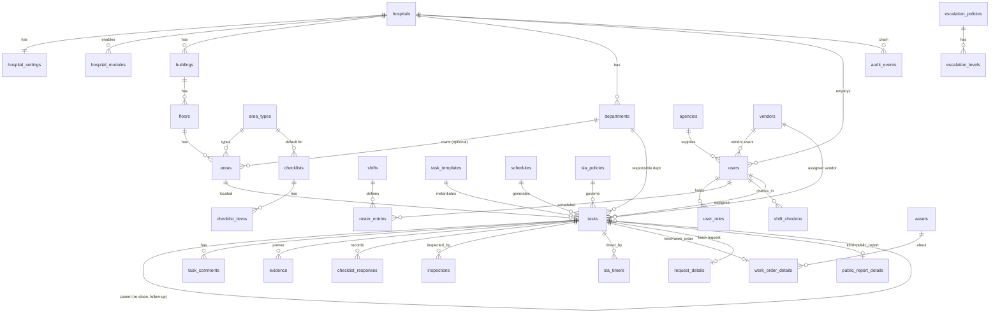

# Data model

PostgreSQL 16. Conventions:
- Primary keys `uuid` (v7, time-ordered) unless noted. Times are `timestamptz` (UTC).
- **Every tenant table has `hospital_id uuid NOT NULL`** and the standard RLS policy (§4). Composite foreign keys
  `(hospital_id, x_id)` stop a row pointing at another hospital's row even if application code is wrong.
- `created_at`, `updated_at` on mutable tables. Soft delete (`archived_at`) for config; **no deletes** on evidence/audit.
- No patient data anywhere (hard rule 1). Beds are areas (`area_type = bed`), identified by bed code only.

## 1. ERD (core)



## 2. Tables by module

### org
| Table | Key columns |
|---|---|
| `hospitals` | id, code (short, unique, used in login URL), name, city, timezone (default `Asia/Kolkata`), status, created_at. *Not* RLS-scoped by hospital_id (it **is** the tenant); RLS: `id = current_setting('app.hospital_id')`. |
| `hospital_settings` | hospital_id PK, schema_version, settings jsonb (validated by `HospitalSettingsV1`), updated_by |
| `hospital_modules` | hospital_id, module (enum), enabled, enabled_at |
| `buildings` | id, hospital_id, name, code, sort |
| `floors` | id, hospital_id, building_id, label ("G", "1", "B1"), level int (for ordering), sort |
| `area_types` | id, hospital_id, key (ward, icu, ot, washroom, corridor, bed, lobby, lab, kitchen, …), name_i18n jsonb, default_risk, evidence_rules jsonb |
| `areas` | id, hospital_id, floor_id, area_type_id, department_id null, parent_area_id null (bed → ward), code, name, risk_level (high/medium/low), status (active/out_of_service), qr_token_version int, grid_x/grid_y/grid_w (layout on the status board) |
| `departments` | id, hospital_id, name, kind (clinical_unit / support / admin), head_user_id null |

### staff & auth
| Table | Key columns |
|---|---|
| `users` | id, hospital_id, employee_code, display_name, email (citext, unique per hospital, null allowed), phone_enc bytea null + phone_hash (lookup), preferred_language (en/kn/hi), employment_type (employee/agency/vendor), agency_id null, vendor_id null, department_id null, status (active/deactivated/erased), deactivated_at, erased_at |
| `user_roles` | id, hospital_id, user_id, role (enum), scope_type (hospital/department/area/vendor), scope_id null |
| `agencies` | id, hospital_id, name, contact_email |
| `vendors` | id, hospital_id, name, categories text[], contract_ref, sla_policy_id null, contact_email |
| `shifts` | id, hospital_id, name, starts_at time, ends_at time, crosses_midnight bool |
| `roster_entries` | id, hospital_id, user_id, shift_id, date, zone_area_ids uuid[] (or department_id) |
| `shift_checkins` | id, hospital_id, user_id, roster_entry_id, checked_in_at (server), method (qr/pin/app), area_id null, checked_out_at — **append-only** (Labour Codes) |
| `devices` | id, hospital_id, label, registered_by, device_key_hash, last_seen_at, revoked_at |
| `credentials` | user_id PK, hospital_id, password_hash (argon2id) null, pin_hash null, totp_secret_enc null, totp_enabled_at, failed_attempts, locked_until |
| `otp_challenges` | id, hospital_id, user_id, channel (email), code_hash, expires_at (5 min), attempts (max 5), consumed_at, ip_hash |
| `sessions` | id, hospital_id, user_id, device_id null, user_agent_summary, created_at, last_seen_at, revoked_at, revoke_reason |
| `refresh_tokens` | id, session_id, token_hash, parent_id, issued_at, expires_at, used_at, revoked_at (reuse → revoke whole session family) |
| `platform_users` | Oglos staff; **not** a tenant table; separate auth, TOTP mandatory |

### tasks, SLA, schedules
| Table | Key columns |
|---|---|
| `task_templates` | id, hospital_id, module, kind, title_i18n, default_checklist_id, requires_start_scan, requires_end_scan, requires_photo, verification (always/sampled/none), sla_policy_id, est_minutes |
| `tasks` | id, hospital_id, number (per-hospital sequence, shown as `HK-000123`), kind, module, source (scheduled/requested/triggered/reported), template_id, schedule_id null, occurrence_at null, parent_task_id null, title, description (≤1000, no patient data), area_id null, department_id, priority (critical/high/normal/low), status, sla_state, assignee_id null, vendor_id null, requester_id null, verifier_id null, due_at, response_due_at, accepted_at, started_at, submitted_at, verified_at, closed_at, hold_reason, cancel_reason, verification_required bool, created_by, created_at |
| `task_comments` | id, hospital_id, task_id, author_id, body (≤2000), created_at — append-only (edits are new comments) |
| `checklists` / `checklist_items` | id, hospital_id, name_i18n · item: checklist_id, label_i18n, required, kind (check/number/choice), sort |
| `checklist_responses` | id, hospital_id, task_id, item_id, value jsonb, answered_by, server_ts — append-only |
| `schedules` | id, hospital_id, template_id, area_id null / area_type_id null, rrule text, timezone, active, materialised_until |
| `sla_policies` | id, hospital_id, name, priority, response_minutes, resolution_minutes, verify_minutes, at_risk_pct, escalation_policy_id, business_hours_only bool |
| `escalation_policies` / `escalation_levels` | level, after_minutes, target_role, target_scope (task dept/area/hospital), channels |
| `sla_timers` | id, hospital_id, task_id, clock (response/resolution/verify), kind (at_risk/due/escalate), level, fire_at, fired_at, cancelled_at |
| `timer_buckets` | hospital_id PK, next_fire_at — cross-tenant sweep index, no personal data (not RLS-scoped) |
| `assignment_rules` | id, hospital_id, module, area_type_id null, department_id null, strategy (roster_least_loaded/fixed_user/supervisor_queue), params |

### evidence & housekeeping
| Table | Key columns |
|---|---|
| `evidence` | id, hospital_id, task_id, kind (photo), object_key, sha256, bytes, mime, status (processing/ready/rejected/purged), server_received_at, client_captured_at null, captured_by, area_id, watermark_text, purged_at — immutable after task submit (trigger) |
| `qr_scans` | id, hospital_id, task_id null, area_id, user_id, token_version, phase (start/end/checkin), server_ts, client_scanned_at null, accepted bool, reject_reason — append-only |
| `inspections` | id, hospital_id, task_id, inspector_id, reason (high_risk/random_sample/manual), score numeric(5,2), pass_mark, passed, items jsonb, server_ts — append-only |
| `sampling_runs` | id, hospital_id, date, seed, pct, selected_task_ids uuid[] |
| `area_status` (materialised) | hospital_id, area_id, status (clean_verified/due/in_progress/awaiting_inspection/needs_attention/out_of_service), current_task_id, last_verified_at, next_due_at — updated by service on events; feeds the board |

### maintenance, requests, public
| Table | Key columns |
|---|---|
| `assets` | id, hospital_id, code, name, category (electrical/plumbing/hvac/lift/civil/biomedical), area_id, vendor_id null, amc_until date null, status |
| `work_order_details` | task_id PK, hospital_id, category, asset_id null, reported_symptom, resolution_notes, parts_note, vendor_ref |
| `request_details` | task_id PK, hospital_id, from_department_id, to_department_id, handoff_to_user_id null |
| `public_reports` / `public_report_details` | id, hospital_id, area_id, issue_key, note (≤280), photo_evidence_id null, reporter_phone_enc null, consent_version null, consent_at null, ip_hash, created_at |
| `qr_codes` | hospital_id, area_id, purpose (staff/public), version, issued_at, revoked_at (the token itself is HMAC-derived, not stored) |

### notifications, reports, privacy
| Table | Key columns |
|---|---|
| `notifications` | id, hospital_id, user_id, template_key, params jsonb (ids only), read_at, created_at |
| `notification_deliveries` | id, hospital_id, notification_id, channel (in_app/web_push/email/whatsapp/sms), status, attempts, next_attempt_at, provider_ref, last_error_code |
| `push_subscriptions` | id, hospital_id, user_id, endpoint, keys_enc, created_at, revoked_at |
| `exports` | id, hospital_id, kind (nabh_audit/sla/scorecard), params, requested_by, status, object_key, expires_at |
| `privacy_notices` / `notice_acknowledgements` | notice: id, hospital_id null (platform default), audience (staff/public), version, locale, body_md · ack: user_id, notice_id, version, server_ts |
| `data_requests` | id, hospital_id, user_id, kind (export/correct/erase), status, handled_by, server_ts |
| `breach_register` | id, hospital_id null, detected_at, contained_at, description, categories, affected_count_est, hospital_notified_at, certin_reported_at, status, postmortem_url |
| `audit_events` | id bigserial-ish, hospital_id, seq bigint, actor_id null, actor_role, entity_type, entity_id, task_id null, action, from_state, to_state, payload jsonb, server_ts, prev_hash bytea, hash bytea — **INSERT only** |

## 3. Key indexes

```sql
-- tasks: the hot table
CREATE INDEX ON tasks (hospital_id, status, due_at);
CREATE INDEX ON tasks (hospital_id, assignee_id, status) WHERE status NOT IN ('closed','cancelled');
CREATE INDEX ON tasks (hospital_id, area_id, created_at DESC);
CREATE INDEX ON tasks (hospital_id, department_id, status);
CREATE INDEX ON tasks (hospital_id, vendor_id, status) WHERE vendor_id IS NOT NULL;
CREATE UNIQUE INDEX ON tasks (hospital_id, number);
CREATE UNIQUE INDEX ON tasks (schedule_id, occurrence_at) WHERE schedule_id IS NOT NULL;  -- idempotent materialisation

CREATE INDEX ON sla_timers (fire_at) WHERE fired_at IS NULL AND cancelled_at IS NULL;
CREATE UNIQUE INDEX ON audit_events (hospital_id, seq);
CREATE INDEX ON audit_events (hospital_id, task_id, seq);
CREATE INDEX ON audit_events (hospital_id, server_ts);
CREATE UNIQUE INDEX ON users (hospital_id, lower(email)) WHERE email IS NOT NULL;
CREATE UNIQUE INDEX ON users (hospital_id, employee_code);
CREATE INDEX ON users (hospital_id, phone_hash);
CREATE INDEX ON evidence (hospital_id, task_id);
CREATE INDEX ON notifications (hospital_id, user_id, read_at, created_at DESC);
CREATE INDEX ON notification_deliveries (next_attempt_at) WHERE status = 'pending';
CREATE INDEX ON area_status (hospital_id, status);
```

## 4. Row-Level Security

Applied by one Alembic helper `enable_tenant_rls(table)` for every tenant table:

```sql
ALTER TABLE {t} ENABLE ROW LEVEL SECURITY;
ALTER TABLE {t} FORCE ROW LEVEL SECURITY;
CREATE POLICY tenant_isolation ON {t}
  USING      (hospital_id = current_setting('app.hospital_id', true)::uuid)
  WITH CHECK (hospital_id = current_setting('app.hospital_id', true)::uuid);
```
- If `app.hospital_id` is unset, `current_setting(..., true)` returns NULL, the comparison is NULL, and **no rows** are visible or writable (deny by default).
- `SET LOCAL` limits the value to the current transaction, so a pooled connection can't leak a tenant into the next request.
- `oglos_app` has no `BYPASSRLS`. Only `oglos_platform` has it, and only the platform module uses it.
- CI test: a migration check lists every table with a `hospital_id` column and fails if RLS is not enabled and forced on it.

**Append-only enforcement**
```sql
REVOKE UPDATE, DELETE ON audit_events, qr_scans, inspections, checklist_responses, task_comments, shift_checkins FROM oglos_app;
CREATE TRIGGER evidence_immutable BEFORE UPDATE OR DELETE ON evidence
  FOR EACH ROW EXECUTE FUNCTION forbid_change_after_submit();   -- allows only retention purge via SECURITY DEFINER fn
```

## 5. Personal data and erasure

Personal fields are **only** in `users` (name, email, phone, employee code), `public_reports.reporter_phone_enc` and `push_subscriptions`.
Everything else references people by `user_id`. Erasure (`status = erased`) overwrites `display_name` with `Staff #<employee_code or short id>`, nulls email/phone/credentials, and revokes sessions. Audit events keep the `user_id`, so the chain stays valid and the records stay anonymised. Full inventory: `compliance/data-inventory.md`.
