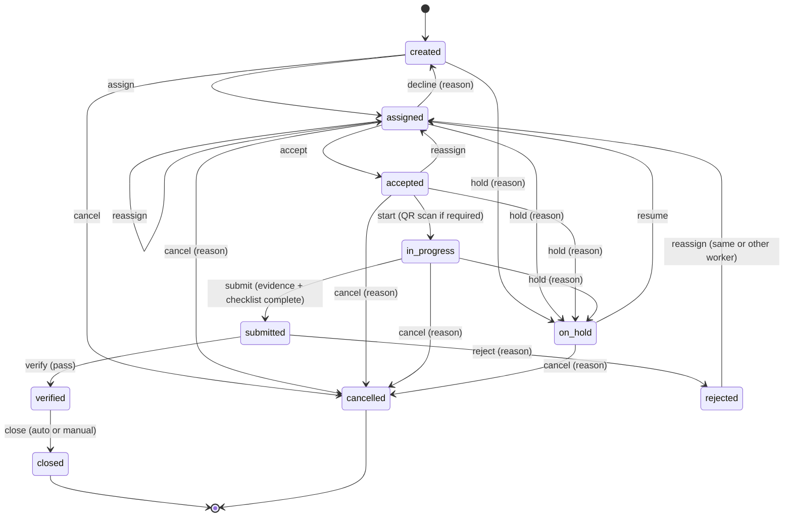
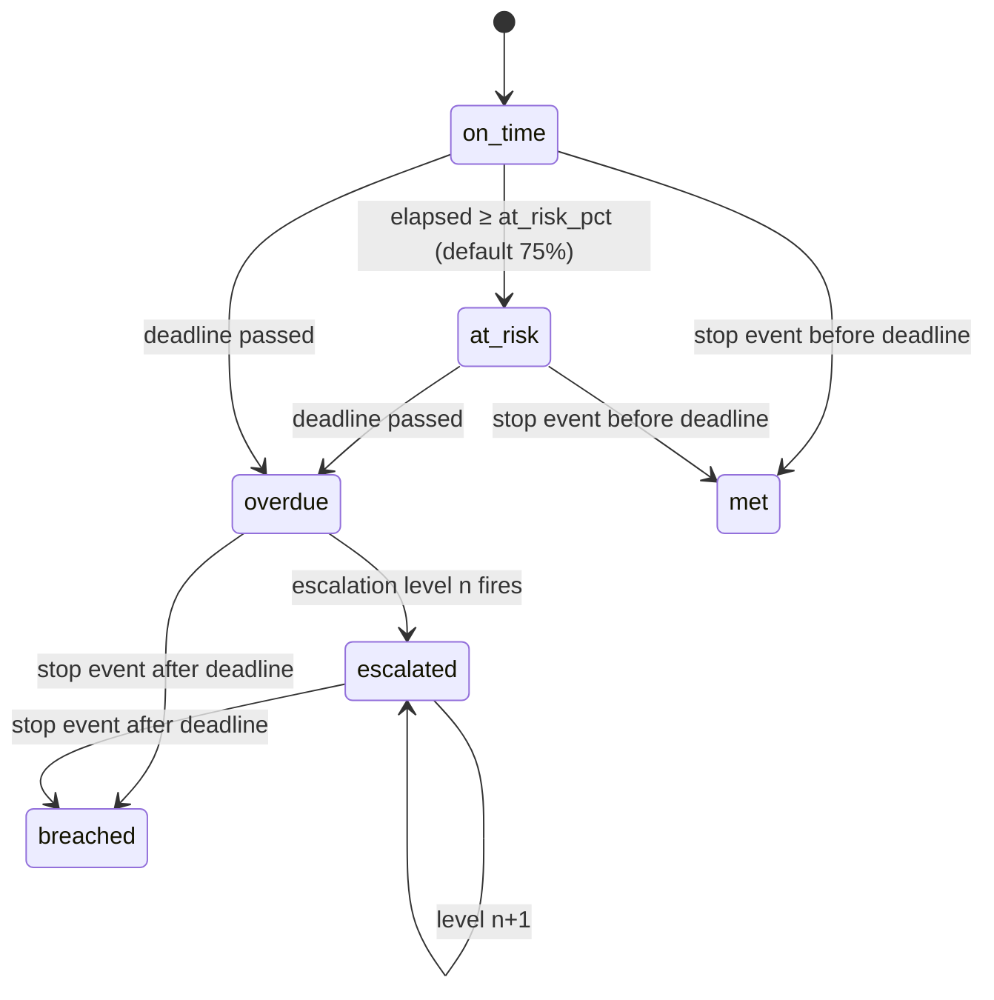

# Task state machine

All task status changes go through `app/modules/tasks/state_machine.py::transition(task, action, actor, payload)`.
No other code writes `tasks.status` (CLAUDE.md hard rule 4). A DB trigger rejects `UPDATE tasks SET status` unless the
session variable `app.sm_token` set by the service is present, so mistakes fail loudly in tests.

## 1. Work states



| Action | From | To | Who (permission) | Guards |
|---|---|---|---|---|
| assign | created | assigned | `task.assign` (supervisor, dept head, ops mgr; or the assignment engine) | assignee active, on roster or vendor user of the assigned vendor |
| decline | assigned | created | assignee | reason required |
| reassign | assigned, accepted, rejected | assigned | `task.assign` | new assignee ≠ blank |
| accept | assigned | accepted | assignee | — |
| start | accepted | in_progress | assignee | if `requires_start_scan`: valid area QR token for this task's area |
| submit | in_progress | submitted | assignee | if `requires_end_scan`: valid QR; checklist required items done; if `requires_photo`: ≥1 evidence `ready` or `processing` |
| verify | submitted | verified | `task.verify` within scope; **not the assignee** | inspection score ≥ pass mark if an inspection is attached |
| reject | submitted | rejected | `task.verify`; not the assignee | reason required |
| close | verified | closed | system (auto after verify) or `task.close` | — |
| hold | created…in_progress | on_hold | `task.hold` (supervisor+) or assignee **requesting** a hold (needs approval, see open questions) | reason from list + free text |
| resume | on_hold | assigned | `task.hold` | — |
| cancel | any non-terminal | cancelled | `task.cancel` (supervisor+, or the requester before acceptance) | reason required |

**Tasks that don't need verification:** if a task template has `verification = none` (for example, a low-risk area outside the random sample), `submit` moves straight on to `verified → closed` through system actions, and each step is still audited. Sampling decides at submit time whether verification is required (decision 15).

**Failed inspection** (decision 16): `reject` on a cleaning task (or an inspection that scores below the pass mark on a verified task) emits `InspectionFailed`, which in the same transaction creates a **new re-clean task** linked by `parent_task_id` and writes a score event against the original assignee.

## 2. SLA track (parallel)

`tasks.sla_state` is **not** set by actions; only the SLA timer service writes it, through the same state-machine module (`sla_transition`).



Each task can have two clocks from its `sla_policy`:
| Clock | Starts | Stops (default) |
|---|---|---|
| response | `created` | `accepted` |
| resolution | `created` | `submitted` (the worker's part); verification has its own supervisor clock (`verify_within`) |

- `on_hold` **pauses** both clocks (paused time is stored; the deadline moves). Cancelled tasks drop their timers.
- Each clock has rows in `sla_timers` (`at_risk`, `due`, `escalate_1…n`). Firing a row writes an audit event and the next notification.
- **Escalation chain** (decision 19, configurable): level 1 supervisor → level 2 department head → level 3 operations manager. Gaps between levels come from `escalation_levels.after_minutes`.

## 3. Audit event per transition

Every successful transition writes, in the same DB transaction:
```
audit_events(id, hospital_id, seq, actor_id, actor_role, task_id, entity_type='task', entity_id,
             action, from_state, to_state, payload jsonb, server_ts, prev_hash, hash)
```
- `payload` holds IDs and reasons only, never names or free text containing personal data (the reason text is length-capped and shown to staff only).
- `hash = sha256(prev_hash || canonical_json(fields except hash))`; the chain is per hospital, ordered by `seq`, and serialised with `pg_advisory_xact_lock(hospital lock key)`.
- A failed transition (guard failed) writes nothing and returns `409` with a machine code (`TASK_INVALID_TRANSITION`, `QR_REQUIRED`, `EVIDENCE_REQUIRED`, `VERIFIER_IS_ASSIGNEE` …).

## 4. Tests required

- Table-driven test of every `(state, action)` pair: allowed ones succeed, all others return 409.
- Each guard has a positive and a negative test.
- Property test: random action sequences never reach a state outside the diagram, and the audit chain verifies afterwards.
- SLA: freeze time; check that at-risk, overdue, escalation levels and the hold pause fire exactly once even when two workers sweep at the same time.
